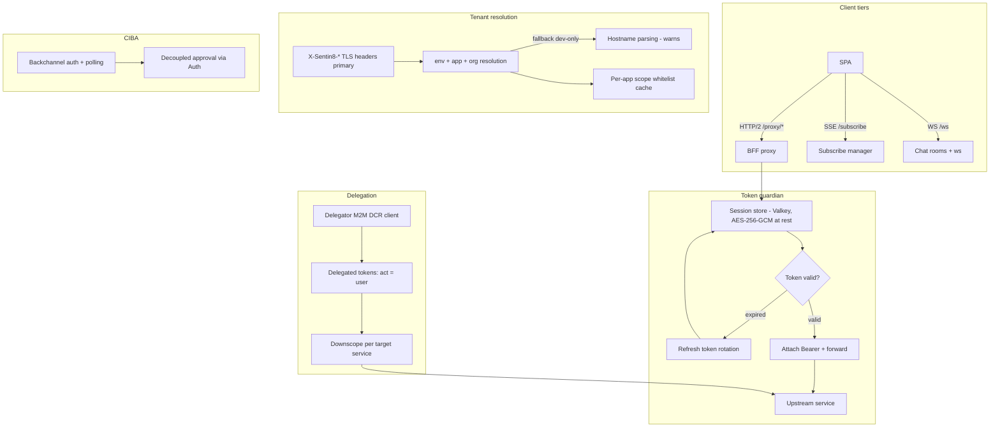

# Design Doc: Sentin8:BFF - Backend-for-Frontend & Delegation Gateway

## 1. Summary

Sentin8:BFF is the platform's backend-for-frontend and delegation
gateway. All client-to-backend traffic (web SPA, mobile) flows through
it: the BFF authenticates users, holds OAuth tokens server-side in an
encrypted session store, attaches tokens to proxied requests
(`/proxy/{service}/...`), transparently refreshes expired tokens, and
downscopes delegation tokens per target service. It also bridges the
three transport tiers - queries/mutations over HTTP/2, subscriptions
over SSE, chat over WebSocket.

## 2. Motivation

- **Tokens never reach the client.** Browsers and mobile apps cannot be
  trusted with access/refresh tokens (XSS, storage exfiltration). The
  BFF holds them server-side; the client authenticates with a
  session cookie plus a CSRF token for mutations.
- **Per-app tenant resolution.** Every proxied request must resolve
  (env, app, org) before forwarding; the platform's TLS layer injects
  authoritative context headers the BFF consumes - hostname parsing is
  only a loudly-warned fallback for non-TLS local dev.
- **Delegation without a token in the middle.** Cross-tenant trust
  (system→env, user→app) is brokered by cert-bound M2M tokens; the BFF
  issues delegated tokens (`act` claims the originating user) and
  downscopes them per service - never broad-scope passthrough.
- **Session lifetime independent from token lifetime.** Idle timeout
  sessions with transparent token refresh let the SPA stay valid across
  provider outages without exposing refresh logic to the client.

## 3. Architecture & High-Level Design

- **Proxy** - validates the session, decrypts the access token, strips
  client-supplied context headers, attaches `Authorization: Bearer`,
  and forwards; refresh happens transparently on expiry with the
  rotated refresh token re-encrypted into the session.
- **Session** - Valkey keyed `bff:session:{id}`, TTL = idle timeout;
  tokens encrypted at rest (AES-256-GCM) so a Valkey dump is not a
  token dump. `domain` is the app instance's domain; sessions are
  bound to the application. Multi-session management (`/v1/auth/sessions`)
  lists and revokes the caller's sessions per-device; revocation
  destroys the record and revokes the stored refresh token.
- **Subscriptions** - a manager multiplexes Bus SSE consumers and
  per-connection SSE pushes; delegation subscriptions apply per-env
  authorization before data flows.
- **Chat** - WebSocket rooms (the only bidirectional tier).
- **CIBA** - the BFF exposes backchannel authorization + polling for
  decoupled approval flows (authenticator apps).

## 4. Key Traits and Data Structures

- **`SessionStore`** - the Valkey-backed encrypted session store; the
  session carries decrypted-on-demand tokens, user identity, tenant
  ids, CSRF token, and expiry.
- **Tenant resolution types** - header-first resolution from
  `X-Sentin8-Env-Id` / `X-Sentin8-App-Id`; org resolved from env via
  the platform tables (context-first reads, same-transaction RLS
  context).
- **Per-app scope whitelist** - lazily loaded from
  `sentin8_sys_app_instances` with an in-memory cache; the BFF refuses
  to proxy scopes outside the app's grant.
- **Server tagger** - tags upstream servers per request for
  observability (which service instance served which proxied call).
- **Key rotation** - session/token encryption keys rotate with a
  decrypt-old, encrypt-new re-wrap so sessions survive rotation.

## 5. Rationale, Trade-offs, and Alternatives

- **Server-side tokens (BFF pattern).** The SPA calls the BFF; the BFF
  holds tokens. Alternatives - SPA-held access tokens (XSS risk), or
  handle-only sessions with per-request token fetch (doubles latency
  per call). Server-side holding wins on security and call economy;
  the cost is BFF availability becoming critical (mitigated by
  horizontal scale).
- **Encrypted sessions at rest.** AES-256-GCM with rotating keys; a
  stolen Valkey snapshot yields ciphertext only. Trade-off: decrypt on
  every request (microseconds vs. an entire credential class).
- **CSRF token in session metadata.** Mutations require the CSRF header
  bound to the session; SameSite cookies alone don't defend
  cross-origin POSTs from embedded pages. The metadata shape
  (never carrying tokens) is pinned by contract tests in the
  shared bff-contracts crate.
- **Scope whitelist per app instance.** The BFF is the last line
  against a compromised SPA asking for more than its app's grant;
  checking the whitelist per request (cached) is cheaper than
  trusting the upstream to re-check. The DB read uses qualified
  schema names - `search_path` is `bff, public`, so unqualified
  cross-schema names fail.
- **Header-first tenant resolution with a loud fallback.** TLS injects
  the tenant context; the hostname fallback exists only for non-TLS
  local dev, warns on every use, and is env-flag gated (disable in
  prod). Silent fallback would mask misrouting bugs as data mixing.
- **Delegated tokens with `act`.** The delegation gateway mints
  delegated tokens (`token_tp: "delegated"`) whose `act` claim carries
  the originating user; the target service sees both the broker and
  the human. Blind passthrough of the user token to verticals would
  grant the app everything the user has - downscoping is the point.
- **Three transport tiers, not one.** Queries/mutations are
  request/response (HTTP/2), subscriptions are one-way push (SSE),
  chat needs bidirectional (WS). Using WS for metrics/events would
  conflate connection semantics; SSE is cheaper and survives proxies.
- **CIBA server-side.** The BFF owns the polling loop and the
  `auth_req_id` binding so the SPA polls a session-scoped endpoint
  instead of holding CIBA credentials.
- **Rejected: stateless JWT-only sessions.** Stateless tokens can't be
  revoked mid-session; server sessions are revocable per session id
  (admin revoke lists sessions).
- **Rejected: BFF as business-logic home.** Delegation, tenant
  resolution, and downscoping live in shared SDKs/backend services;
  the BFF stays a transport guardian.

## 6. Internal Implementation & Invariants (Private Design)

- **Invariants:**
  - Tokens never leave the server except as `Authorization` headers on
    proxied requests - responses never echo them; session metadata
    (`SessionMetadata`) is the only client-visible shape and carries no
    token fields.
  - The session's `domain` is the app instance's domain; a session
    cookie must not leak across sibling app instances.
  - Tenant resolution: TLS headers primary; hostname fallback warns and
    is env-flag-gated. `org_id` is never carried in headers - resolved
    from `env_id` server-side.
  - Every proxied request validates the session before decryption;
    invalid/absent sessions get 401, not a default tenant.
  - Token refresh is atomic per session (the rotated pair replaces the
    old pair in one write); a failed refresh terminates the session.
  - Proxied requests strip client-supplied `X-Sentin8-*` headers -
    only TLS-injected context is trusted upstream.
  - Delegation tokens are always downscoped: the target service sees
    only the scopes it needs, never the user's full set.
- **Boot (shell-owned).** The shell owns the listener/middleware stack;
  the BFF registers its delegator M2M client via DCR (cert-bound),
  builds the session store, warms the scope-whitelist cache, and
  mounts the three transport tiers. PostgreSQL 18+ is enforced.
- **Subscribe manager.** Multiplexes: one Bus consumer per
  (stream family, consumer group) with fan-out to N client SSE
  connections; per-connection authorization re-checked on
  (re)connect, not only on subscribe.
- **Chat.** Rooms are per env/app; the WS upgrade authenticates the
  session before upgrade; presence and message flows are room-scoped.

## 7. Unresolved Questions / Future Designs

- Multi-region session affinity keeps the regional store (correct for a
  regional issuer topology) and adds stickiness when multi-region lands.
- Per-request token minting uses the token-exchange pattern Auth already
  supports (actor tokens): mint an actor token per high-security request.
- A mobile push subscription bridge is live (BFF-5): a third subscription
  sink alongside SSE. `POST /subscribe/push` registers a session-bound
  device token (DELETE removes it); the SSE fan-out (`push_event`) taps
  registered sessions and enqueues into BFF's local `post_outbox`, which
  the `bff-post` pusher relays to Post's send API (`sentin8:post:write`,
  DBX - no direct post.inbox writes). Post's `push` gateway delivers
  (stub today; real FCM/APNs adapters drop in behind the same contract,
  POST-4).
- Large uploads route through the Storage presigned-PUT pattern (the BFF mints
  the presigned URL).

---

**Architecture & Design:** sentin8:bff and its underlying concepts were designed by [Hamid Jahanzad](https://www.linkedin.com/in/hamidjahanzad/).
